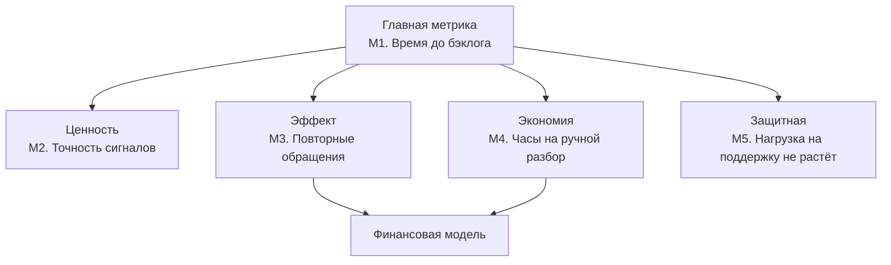

# Компонент 5. Эффект внедрения: метрики успеха

## 1. Дерево метрик

Главная метрика — время от первого обращения по повторяющейся проблеме до её попадания в бэклог продуктовой команды: именно это и обещает агент. Четыре опорные метрики показывают, полезны ли сигналы, есть ли эффект в обращениях и деньгах и не растёт ли нагрузка на поддержку. Две из них переводятся в деньги и питают финансовую модель.

## 2. Карточки метрик

У каждой метрики есть способ получить значение «до» из истории за 12 месяцев, способ отслеживать её после запуска и запасной вариант на случай, если данных нет. Целевые значения — допущения, которые утверждаем с заказчиком после замера базы.

### M1. Время до бэклога (главная)

| Поле | Содержание |
|---|---|
| Формула | Медиана (дата создания задачи в бэклоге − дата первого обращения по теме), дней, по темам, принятым за период |
| Зачем | Прямо отражает цель: пожелания доходят до продукта быстрее |
| Источник | Тикет-система (дата первого обращения), трекер (дата задачи), хранилище агента (связь темы и задачи) |
| Ретроспективный сбор | Прогнать агента по истории за 12 месяцев и получить темы с датами первых обращений; для 30 крупнейших тем аналитик находит задачи в трекере и считает медиану «как было» |
| Текущий сбор | Автоматически по каждому сигналу; дашборд, еженедельно |
| Запасной вариант | Если задачи в трекере не находятся — опрос владельцев продуктов по 20 главным темам года: «когда вы узнали о проблеме» |
| Цель [допущение] | Медиана не больше T + 7 дней: порог повторяемости плюс неделя на разбор командой |

### M2. Точность сигналов (ценность)

| Поле | Содержание |
|---|---|
| Формула | Принятые в бэклог / (принятые + «дубль» + «не релевантно») за месяц. Вторая сторона — полнота: доля известных проблем года, которые агент находит на истории |
| Зачем | Команды должны доверять сигналам, иначе главная метрика не сдвинется |
| Источник | Отметки команд в трекере, хранилище агента |
| Ретроспективный сбор | На прогоне по истории владелец продукта и руководитель поддержки размечают сигналы, которые агент выдал бы за год |
| Текущий сбор | Отметки команд по каждому сигналу; дашборд, ежемесячно |
| Запасной вариант | Если команды не ставят отметки — эксперт ежемесячно оценивает 20 случайных сигналов |
| Цель [допущение] | Не меньше 60% принятых на пилоте; ниже 40% — пересматриваем порог и промпт |

### M3. Повторные обращения по исправленным темам (эффект)

| Поле | Содержание |
|---|---|
| Формула | Обращения по теме за 30 дней после релиза исправления / за 30 дней до него |
| Зачем | Показывает, что устранение причин снижает поток в поддержку |
| Источник | Хранилище агента (темы и обращения), трекер (дата релиза) |
| Ретроспективный сбор | Для проблем, исправленных за прошедший год, — то же соотношение по истории: база без агента, учитывает естественное снижение |
| Текущий сбор | Агент продолжает считать обращения по теме после статуса «исправлено»; ежемесячно |
| Запасной вариант | Если релиз не связан с темой — обращения по продукту на 100 активных клиентов до и после |
| Цель | Направление — снижение; величину оцениваем на пилоте, в финансовой модели — через сценарии |

### M4. Часы на ручной разбор обращений (экономия)

| Поле | Содержание |
|---|---|
| Формула | Часы в месяц, которые менеджеры и аналитики тратят на выгрузку и разбор обращений для продуктовых команд |
| Зачем | Прямая экономия труда — основной денежный поток финансовой модели |
| Источник | Опрос, хронометраж, логи выгрузок (раздел 3) |
| Ретроспективный сбор | В кейсе значение неизвестно — замер по разделу 3 до запуска пилота |
| Текущий сбор | Повтор опроса через 3 и 6 месяцев после запуска; логи выгрузок ежемесячно |
| Запасной вариант | Экспертная оценка руководителей поддержки диапазоном «минимум — максимум» |
| Цель | Снижение; величина задаётся сценариями финансовой модели |

### M5. Нагрузка на поддержку не растёт (защитная)

| Поле | Содержание |
|---|---|
| Формула | Среднее время обработки тикета и число действий менеджера на тикет |
| Зачем | Условие кейса: агент работает без дополнительной нагрузки на поддержку |
| Источник | Тикет-система |
| Ретроспективный сбор | История за 12 месяцев с учётом сезонности |
| Текущий сбор | Еженедельно, сравнение с тем же периодом прошлого года |
| Запасной вариант | Опрос менеджеров: появились ли новые действия из-за агента |
| Порог [допущение] | Рост больше 5% — разбор причин до продолжения пилота |

## 3. Как измерить ручной разбор обращений

Сейчас неизвестно, как часто выгружают обращения, кто их анализирует и сколько времени тратит. Поэтому базу для M4 собираем за 2 недели до пилота тремя независимыми способами и сверяем их между собой.

| Способ | Как проводим | Что даёт | Ограничение |
|---|---|---|---|
| Опрос 40 менеджеров | Три вопроса: как часто вы собираете обращения для продукта; сколько минут занимает один раз; кому передаёте | Часы в месяц по каждому и разброс | Самооценка неточна |
| Хронометраж | 5 менеджеров и аналитик фиксируют время на выгрузку и разбор 2 недели | Точное время на одну операцию | Маленькая выборка |
| Логи тикет-системы | Частота и объём выгрузок, кто их делает | Объективная частота | Не показывает время разбора |

Итог: частота из логов × время на одну операцию из хронометража; опрос проверяет порядок величины. Если способы расходятся больше чем вдвое, берём диапазон: нижняя граница идёт в пессимистичный сценарий финансовой модели, верхняя — в оптимистичный.

## 4. Порядок сбора и связь с деньгами

Сначала фиксируем базу, затем сравниваем пилотный продукт с продуктами без агента, чтобы отделить эффект агента от сезонности и общих изменений.

1. Недели 1–2, база: прогон агента по истории за 12 месяцев (M1, M2, M3), замер ручного труда (M4), выгрузка времени обработки тикетов (M5).
2. Недели 3–4, режим наблюдения: сигналы идут не командам, а экспертам; считаем M2.
3. Недели 5–12, пилот на «Вебнефти»: сигналы получает команда. Контроль — 1–2 похожих продукта без агента: эффект = изменение метрики на пилоте минус изменение на контроле.
4. Решение о масштабировании: M1 и M2 достигли целей, M5 не вырос.

| Метрика | Как переводится в деньги |
|---|---|
| M4. Часы на ручной разбор | Сэкономленные часы × стоимость часа с начислениями |
| M3. Повторные обращения | Предотвращённые обращения × среднее время обработки × стоимость часа |
| M1. Время до бэклога | Косвенно: меньше дней жизни проблемы — меньше обращений. Уже входит в M3, отдельно не считаем, чтобы не учесть дважды |
| M2, M5 | В деньги не переводятся: это условия, при которых выгода реальна |
